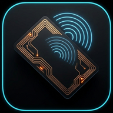

<div align="center">
  
  <h1>RFIDtools</h1>
  <p><b>Proxmark3 in your pocket.</b><br />
  Native Android client · USB &amp; Bluetooth · NFC toolkit</p>

  <p>
    <a href="https://github.com/M35mar/RFIDtools/actions/workflows/android.yml"></a>
    <a href="https://github.com/M35mar/RFIDtools/releases"></a>
    <a href="LICENSE"></a>
    
    
  </p>

  <p>
    <a href="https://github.com/M35mar/RFIDtools/releases/latest/download/pm3-release.apk"><b>⬇️ Download APK</b></a>
    &nbsp;·&nbsp;
    <a href="https://github.com/M35mar/RFIDtools/releases">Releases</a>
    &nbsp;·&nbsp;
    <a href="CHANGELOG.md">Changelog</a>
  </p>
</div>

---

## 💖 Support the project

RFIDtools is free and open source. If it saves you time, you can keep it ad-free:

[](https://github.com/sponsors/M35mar)
[](https://paypal.com/biz/profile/acquistaliSRL)

## ✨ Features

- **Embedded Proxmark3 client** — the Iceman client runs inside the app, over USB or Bluetooth. No Termux, no external process.
- **Device & Console** — transport selector, connection diagnostics, full command console with history and follow mode.
- **PM3 tools** — one-tap LF, HF, Classic autopwn and Ultralight EV1 commands with parameter dialogs.
- **Phone NFC toolkit** — read, restore, APDU console, EV1 counter, Classic credit and change UID. Works without a Proxmark3.
- **Data manager** — dumps, traces, logs and reports, with a built-in hex editor for blocks and pages.
- **Scripts** — import and run `.lua`, `.cmd` and `.py` files with arguments.

## 📲 Install

[**Download `pm3-release.apk`**](https://github.com/M35mar/RFIDtools/releases/latest/download/pm3-release.apk) — signed release, package `com.farmacia.pm3android`.

- Installs over any previous release, so in-app updates work.
- First install is a manual sideload; later updates come from **Info → Links → Check for updates**.
- Debug builds (`pm3-debug.apk`) exist only as CI artifacts and cannot update a release install.

## 🚀 Quick start

1. Install the APK.
2. Connect the Proxmark3 with a USB OTG cable or adapter.
3. Open the app and accept the Android USB permission prompt.
4. Go to **Device → Connect**, then use **Console** or **PM3 tools**.

Using **Bluetooth**? Select it in the Device transport selector, pick your unit and tap **Connect**. Using **NFC**? Open the NFC tab — the phone reader handles tags on its own.

## 🔵 Bluetooth

Bonded Classic units and BLE scan results appear in one list, badged **SPP** or **BLE**. The app remembers the last device only.

| Module | Link | Name | Requirement |
| --- | --- | --- | --- |
| RDV4 BlueShark | Classic SPP | `PM3_RDV4.0` | Pair with PIN `1234`; firmware with `PLATFORM_EXTRAS=BTADDON` |
| Proxmark5 BWM | BLE | `Proxmark5` | No pairing; firmware with `PLATFORM=PM5 PLATFORM_EXTRAS=BWM` |

- Throughput is lower than USB: dumps and traces take longer. **Flashing always requires USB.**
- Android 12+ asks for **Nearby devices**; older versions ask for location to scan.
- BLE is experimental: after a GATT 133 error, retry the connection.

## 📡 NFC toolkit

Everything here runs on the phone alone.

| Tool | What it does |
| --- | --- |
| **Read tag** | Identifies the tag and reads its memory in one tap; save the result as a dump. |
| **Restore tag** | Writes Ultralight/NTAG and MIFARE Classic dumps. Classic needs `hf-mf-<UID>-key.bin`. |
| **APDU console** | Sends raw ISO-DEP commands and shows the response with its status word. |
| **Set counter** | Brings an Ultralight EV1 counter to a target value. Increment only. |
| **Credit** | Increments or decrements a MIFARE Classic value block with a key file. |
| **Change UID** | Rewrites the UID of Gen2/CUID, Gen3/APDU and Ultralight EV1 DirectWrite magic cards. |

- Keys are kept in memory only, never written to disk or to a report.
- Gen1a, Gen1b and backdoor cards cannot be written through Android NFC: use a Proxmark3.
- Calypso secure sessions need a SAM and the licensed spec, so only free data is shown.

## 📋 Requirements

- Android **8.0+** (API 26), **arm64-v8a**.
- Proxmark3 with USB IDs `0x9ac4:0x4b8f`, or RDV4 BlueShark / Proxmark5 BWM.
- Firmware built from the same pinned Proxmark3 commit as the embedded client.
- Firmware is **not** included and never flashed by the app: use a desktop client, over USB.

## 🛠️ Build

<details>
<summary><b>Build from source</b></summary>

Requires JDK 21, Python 3.14, Android SDK platform 37, build-tools 37.0.0, NDK 27.2.12479018, CMake 3.22.1, Git, Bash and Ninja.

```bash
git submodule update --init --recursive
./gradlew :core:pm3:assembleDebug
./gradlew :core:pm3:installDebug   # with a device attached
```

`preBuild` compiles the client into `core/pm3/src/main/jniLibs/arm64-v8a/libpm3android.so` and syncs client resources into `assets/`. Both are build artifacts and are not committed.

</details>

<details>
<summary><b>Release signing</b></summary>

Release builds are signed when `keystore.properties` exists. Back up `release.jks` and the properties file: losing them means no future APK can update an installed release.

```bash
cp keystore.properties.example keystore.properties
# storeFile=release.jks  keyAlias=rfidtools
```

CI signs tagged builds with these repository secrets:

| Secret | Value |
| --- | --- |
| `ANDROID_KEYSTORE_BASE64` | `base64` of `release.jks` |
| `ANDROID_KEYSTORE_PASSWORD` | keystore password |
| `ANDROID_KEY_ALIAS` | `rfidtools` |
| `ANDROID_KEY_PASSWORD` | key password |

</details>

<details>
<summary><b>Tests and CI</b></summary>

```bash
./gradlew :core:pm3:testDebugUnitTest
./gradlew :core:pm3:lintDebug
./gradlew :core:pm3:assembleDebug
```

Every push runs tests, lint and the debug build. A tag such as `1.1.0` (or `v1.1.0`) must match `versionName`, then builds a signed release and publishes `pm3-release.apk`. Bump `versionCode` and `versionName` together in `core/pm3/build.gradle.kts` before tagging.

</details>

## ❓ Troubleshooting

<details>
<summary><b>The Proxmark3 is not detected</b></summary>

Use a data-capable cable and a supported OTG adapter. Confirm USB host mode and that the board enumerates as `0x9ac4:0x4b8f` (`adb shell dumpsys usb`), then replug it and reopen the app.

</details>

<details>
<summary><b>The USB permission prompt does not appear</b></summary>

Reconnect the board and make sure no other app holds the interface. The app waits up to 60 seconds, then returns to `DISCONNECTED`.

</details>

<details>
<summary><b>The connection handshake fails</b></summary>

The firmware must match the pinned client commit: reflash from a PC. Check **Device** diagnostics for VID/PID and interface details.

</details>

<details>
<summary><b>The update check or install fails</b></summary>

The check uses the public GitHub API, so rate limits or an outage can make it fail. Retry from **Info → Links → Check for updates**. Allow **Install unknown apps** for RFIDtools if Android blocks the install.

</details>

<details>
<summary><b>I need to reset client resources</b></summary>

Open **Info → Reset client resources** while disconnected. Dumps, traces, logs and imported scripts are preserved.

</details>

## 🔒 Privacy & security

- `INTERNET` is used only for the GitHub release check and APK download. No analytics, telemetry or ads.
- Client data stays in the app's private storage and leaves only through an explicit share or export.
- The app never installs APKs silently and exposes no network service.
- Imported scripts run with the app's permissions: only import code you trust.

## 📜 License & credits

GPL-3.0, the same as the embedded Proxmark3 client. See [LICENSE](LICENSE) and [CHANGELOG.md](CHANGELOG.md).

- Original **RFIDtools** by [RfidResearchGroup](https://github.com/RfidResearchGroup), rewritten with an in-process client.
- Embedded client: [RfidResearchGroup/proxmark3](https://github.com/RfidResearchGroup/proxmark3).
- Ultralight EV1 counter-reset research by [Quarkslab](https://blog.quarkslab.com/rfid-monotonic-counter-anti-tearing-defeated.html).
- Python execution via [Chaquopy](https://chaquo.com/chaquopy/).
